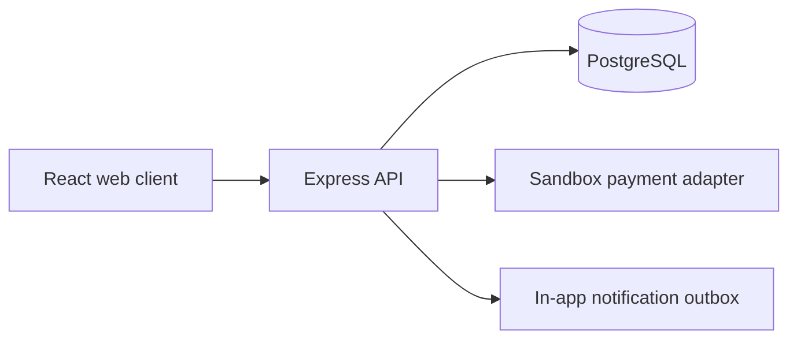
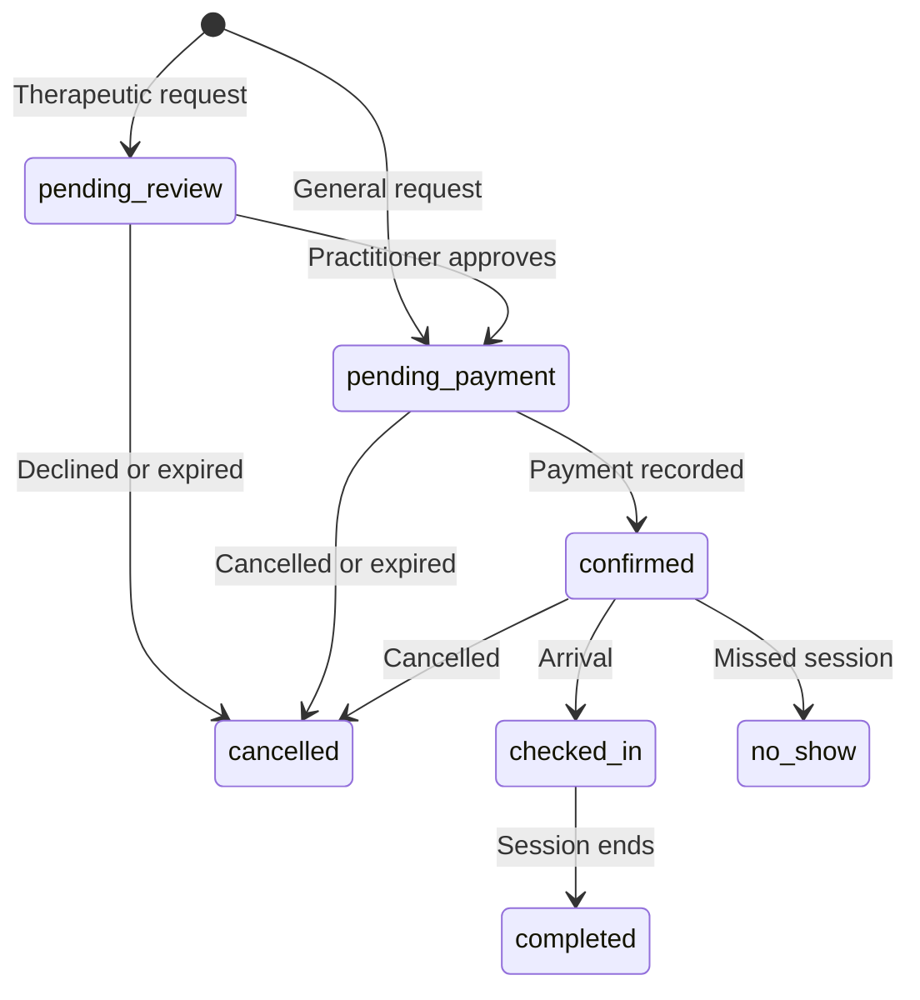
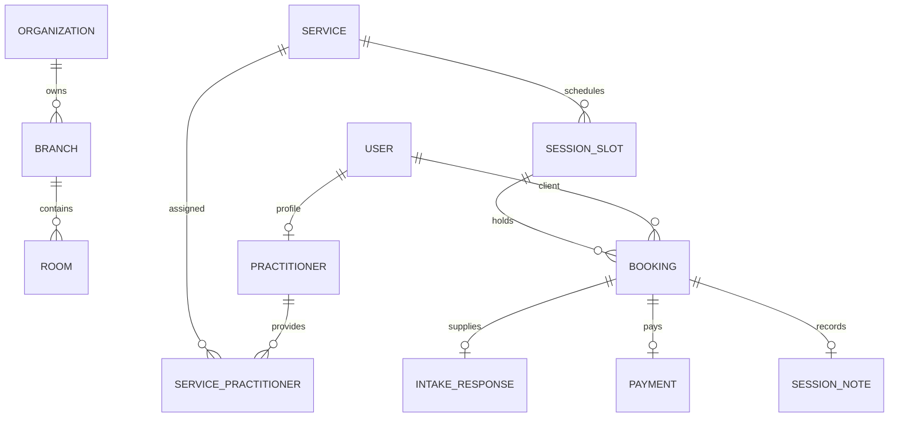

# Product and architecture

## Purpose and users

Sahana is a single-organization, multi-branch booking prototype for wellness classes and practitioner-led therapeutic yoga sessions. Visitors discover sessions; adult clients reserve and manage them; practitioners review assigned intake and record private notes; reception handles attendance and authorized offline payments; branch managers operate schedules and reports; administrators see all branches and audit events.

## Core journey

1. Visitor filters services and checks open times in the branch timezone.
2. Client signs in, chooses a group class or a private practitioner slot, and submits intake/consent when required.
3. A therapeutic request waits for assigned practitioner review. Approval opens a short payment period. Decline releases the resource; a request for information allows the client to update intake.
4. A wellness request goes straight to the short payment period. Sandbox payment confirms and invoices it.
5. Customer views, reschedules, cancels, or exports a non-sensitive calendar entry. Staff checks in the client and completes attendance.

## System map

API modules: `auth.ts` handles cookie sessions and registration; `scheduling.ts` computes zone-aware availability; `routes.ts` holds booking, review, payments, staff and report flows; `core.ts` contains transactions, access checks, encryption and configuration. This modular monolith keeps authorization close to database operations without distributed transaction overhead.

## Booking and payment state

Payment status (`unpaid`, `paid`, `refunded`) and review status (`not_required`, `pending`, `approved`, `declined`, `more_information`) remain separate from booking status. Bookings preserve a price snapshot. Only the sandbox provider performs immediate simulated refunds.

## Data relationships

`session_slots` allocates one practitioner and optional room. A PostgreSQL GiST exclusion constraint blocks overlapping open allocations. A group slot has a capacity and its bookings are counted while the slot row is locked. Private booking transactions lock the practitioner account; each client account is locked to serialize that client's conflict checks. Times are stored as `timestamptz`; a branch's IANA timezone controls local display and availability. Avoid reusing a private slot after cancellation: it is closed and any new reservation creates another allocation.

## Access control

| Role | Booking access | Sensitive intake and notes |
| --- | --- | --- |
| Client | Own bookings | Own intake; no practitioner notes |
| Practitioner | Assigned bookings | Assigned intake and own assigned notes |
| Receptionist | Assigned branch | No intake or private notes |
| Manager | Assigned branch | No intake or private notes |
| Administrator | All branches | No intake or private notes through the API |

Checks are enforced on API requests. Session cookies are HTTP-only and origin-checked on changes. Intake, practitioner review comments and notes use AES-256-GCM with an environment key. Ordinary booking listings omit their contents. The use of a single environment encryption key and missing automated key rotation is a deployment limitation.

## Screens

| Screen | Desktop layout | Mobile layout |
| --- | --- | --- |
| Home | Split hero, services, studio story | Stacked hero and cards |
| Services | Filter bar and 3-column cards | Wrapped filters and single-column cards |
| Booking | Form with sticky summary | Summary and form stacked |
| Client dashboard | Booking list and side panels | Stacked list and panels |
| Staff dashboard | Metrics, queue, sessions | Compact metrics and stacked queue |

## Prioritized work after this build

1. Run migration and concurrency tests against real PostgreSQL; add restore rehearsal and provider-specific webhook tests.
2. Integrate a real Sri Lanka-supported payment provider with reconciliation and explicit refunds.
3. Add email/phone verification, password reset, staff MFA, durable rate limiting and delivery worker.
4. Complete package checkout/redemption and time-limited waitlist offers.
5. Complete multilingual content, accessibility assessment, retention/export/deletion processes, legal review and operating procedures.
